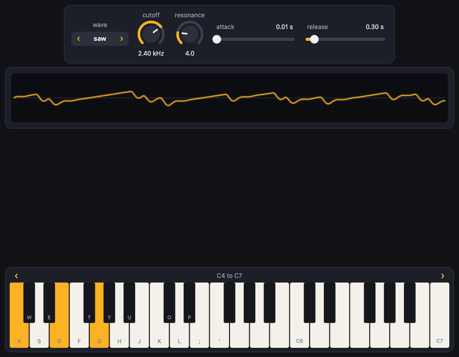
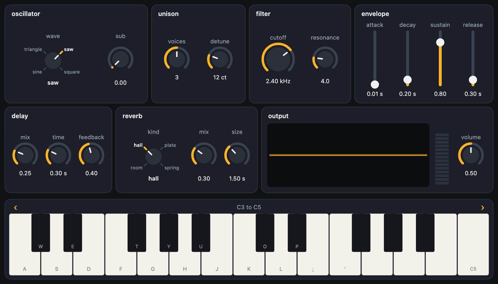
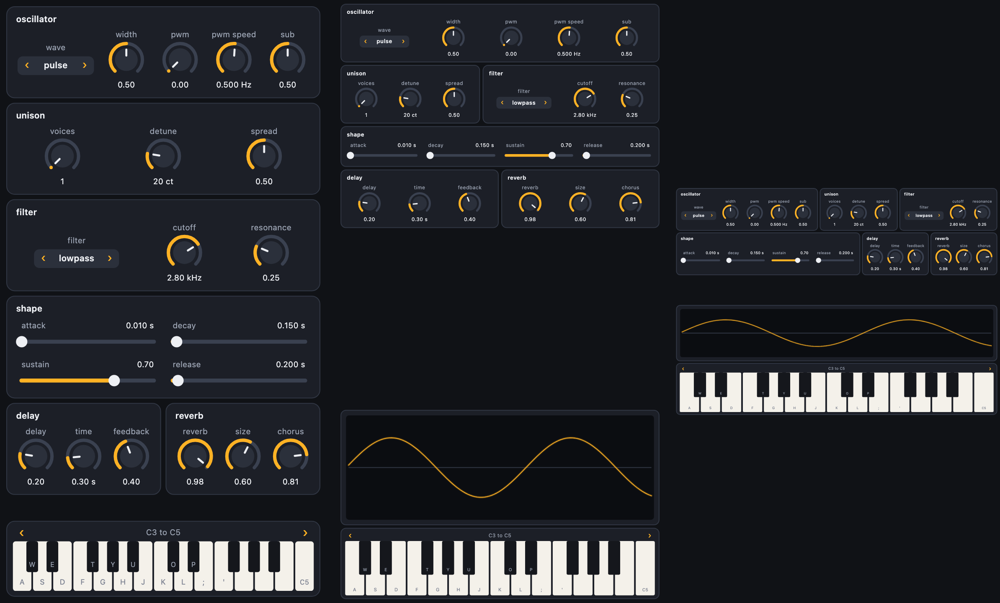
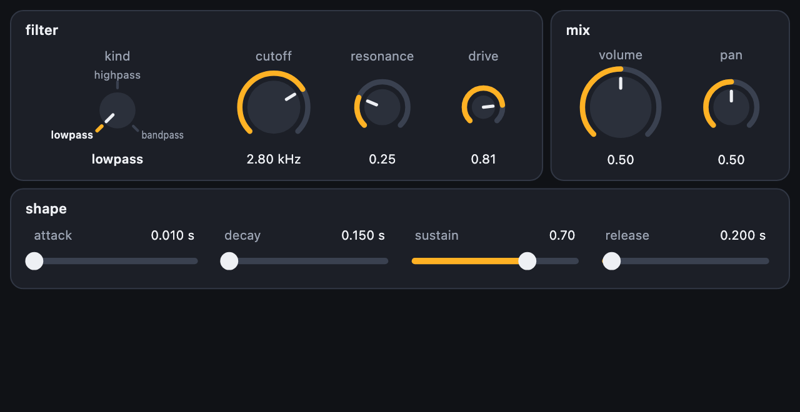
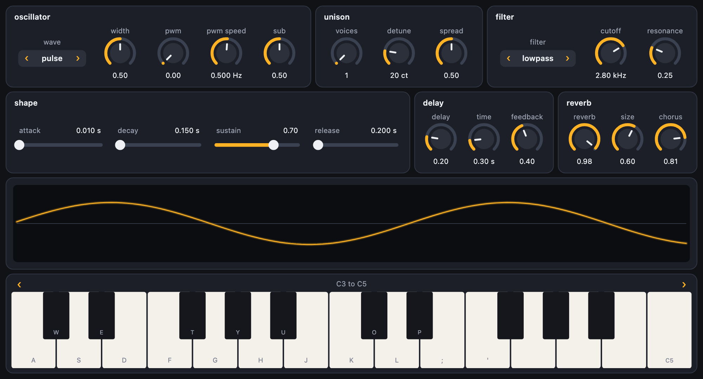
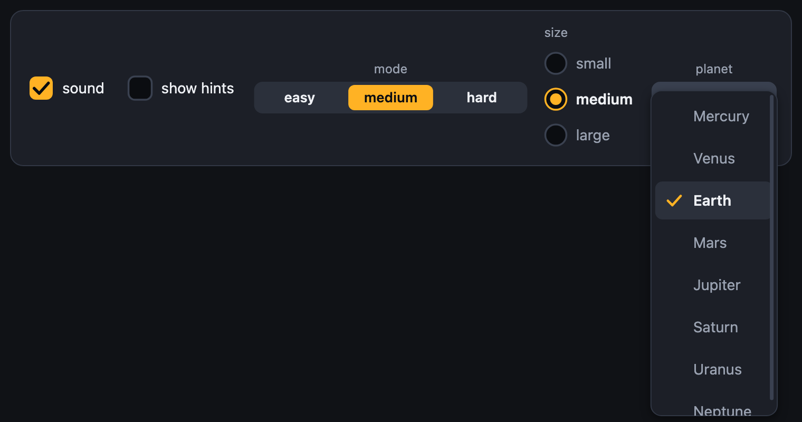
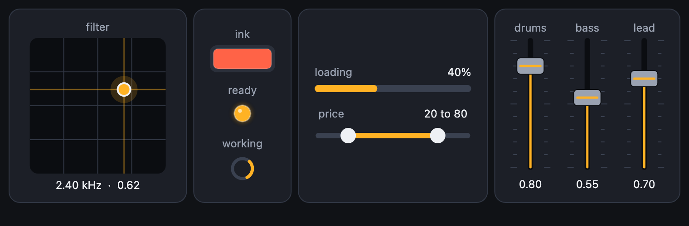
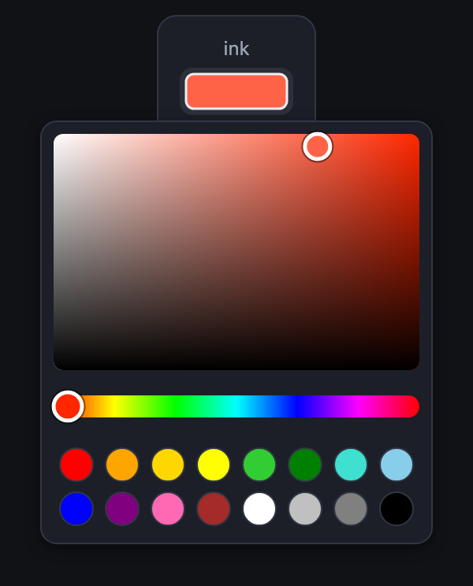

# pydials

[](LICENSE)



pydials puts dials, sliders, buttons, switches, a piano keyboard, a scope and level meters on a [Pyctures](https://github.com/johnwylie70/pyctures) scene, in Python, and it is for enjoying. It is for any age and any level: you write one line and a dial appears, and you turn it and something changes. There is nothing to position, nothing to draw and nothing to wire up. It works with a finger (several at once on the keyboard), with the mouse and with the computer's keys. It is a sibling of [Pyctures](https://github.com/johnwylie70/pyctures) and [synths](https://github.com/johnwylie70/synths-py), designed for projects made in [Circuitry Studio](https://www.circuitry.dev).

Prefer JavaScript? [dials.js](https://github.com/johnwylie70/dials.js) is the same library for [pictures.js](https://github.com/johnwylie70/pictures.js).

## Start with four small scenes

Each one is a whole program. Each scene starts with two lines of imports. [How to run one](#run-it) is just below.

**1. A dial is a number.**

```python
from pyctures import *
from pydials import *

size = dial("size", 10, 150, 60)       # from 10 to 150, starting at 60

def draw():
    background("midnightblue")
    circle(width / 2, height / 2, size, "gold")
```

The dial stands for its number wherever a number is wanted: `circle(x, y, size)`, `size * 2`. `size.value` is the number itself, and `size.value = 100` sets it. Hold Shift while you turn for fine steps, and tap twice to put it back to 60.

**2. Buttons and switches.**

```python
from pyctures import *
from pydials import *

layout(at="bottom")                     # the controls go along the bottom
gravity = dial("gravity", 0, 2000, 900)
kick = button("kick")
trail = toggle("trail")

y = 100
speed = 0

def update(dt):
    global y, speed
    if kick.pressed:                    # true once for each press
        speed = -700
    speed += gravity * dt
    y += speed * dt
    if y > height - 200:
        y = height - 200
        speed = -speed * 0.8

def draw():
    background("rgba(16, 24, 48, 0.08)" if trail else "rgb(16, 24, 48)")
    circle(width / 2, y, 24, "tomato")
```


A `button` is asked in `update`: `kick.pressed` is true once for each press, and `kick.held` for as long as it is down. A `toggle` is a switch: `if trail:`. `select("level", ["easy", "hard"])` is one of a list. The controls line themselves up in the order you make them; `row()` starts another line. [Laying it out](#laying-it-out) has the rest.

**3. A synth you can play.**

```python
from pyctures import *
from synths import *
from pydials import *

lead = make_synth("lead")

dial("cutoff", lead, "cutoff")
dial("resonance", lead, "resonance")
slider("attack", lead, "attack")
scope(lead)
keyboard(lead, octave=4)
```

Each dial is that setting of the synth: it takes its range, its unit and where it starts from the synth, and turning it sets it. The scope draws the wave the synth is making. The keyboard plays it: with fingers, with the mouse, and with the keys A S D F G H J (the white keys) and W E T Y U (the black ones); Z and X step down and up an octave. `make_synth` is from [synths](https://github.com/johnwylie70/synths-py), the sound library.

**4. Watch a number.**

```python
import math
from pyctures import *
from pydials import *

graph = scope("height")
level = meter("speed")
t = 0

def update(dt):
    global t
    t += dt
    graph.push(math.sin(t * 2) * 100)            # one more point on the line
    level.value = abs(math.cos(t * 2))           # from 0 to 1
```

A scope with nothing behind it draws whatever you `push`, so you can watch any number change: a ball's height, a score, a speed. A meter shows a level from 0 to 1.

## Run it

Save a scene as `panel.py` and run it with Pyctures:

```bash
pyctures run panel.py
```

Your browser opens on the scene. Save the file and it runs again.

Nothing here is published yet. Until it is, install it from a copy of this repository with `pip install -e .`, beside Pyctures.

The scenes in `examples/` use a small stand-in synth (`examples/standin_synth.py`, the browser's own oscillators) so that they need no sound library: `pyctures run examples/synth_panel.py`.

## With your hands

- Drag up or to the right on a dial to turn it up. The drag is the dial's until you let go, wherever the pointer wanders: off the dial, off the picture.
- Hold Shift to turn a tenth as far. On a touch screen, pull your finger well away from the dial for a quarter.
- Tap twice to put a dial or slider back where it started.
- Tap a slider's track and the handle comes to your finger; drag the handle to move it from where it is.
- Each finger on the keyboard holds its own key, and sliding along plays each key in turn.
- The arrows above the keys step an octave, again and again while one is held, and the keys slide there. A finger on the strip between the arrows drags the keys sideways; they settle on a whole octave. (Less movement, if your computer is set to ask for it: they jump.)
- A rotary holds at each notch until you have gone most of the way to the next, then clicks over. Tap a name or a notch to go straight to it.
- When there is more than fits, drag a plate's title, or the room between controls, to move the plates; a drag that starts on a dial still turns the dial.
- On a touch screen the controls are made a little bigger, for fingers.

## Laying it out

**There is nothing to do.** Controls line up in the order you make them, on a plate, with the keyboard along the bottom. On a narrow screen the line wraps evenly (six dials are three and three, never five and one), on a touch screen everything is a little bigger, and when the picture changes size it is all laid out again. Controls are drawn a little smaller before a line has to wrap, but never tiny: when there is more than fits, the plates can be moved: with a finger (they carry on a little when it lets go), the mouse wheel, a trackpad or the thin bar beside them, while the keyboard and the scope above it stay where they are. A drag that starts on a dial turns the dial; one that starts on a plate's title, on words or between the plates moves them, passing over dials without turning any; and on a slider that lies across, a finger going along it moves the slider and one going up or down moves the plates. The keyboard is the instrument, and keeps its height: when the plates, the scope and the keyboard do not all fit, the scope is made shorter (never too short to read a wave), and if that is not enough it is the plates that are moved, under a scope and a keyboard that stay where they are. Only on a phone on its side, where there is hardly any height, does the keyboard give up some of its own and the scope go away. `keyboard(lead, height=200)` is kept to, whatever the room.

**A label is a heading.** A `label` made just before some controls is the title of their plate, and they are kept together: a plate moves to the next line whole, never leaving its heading behind. Plates with titles fill the width: they stand side by side, as many to a line as fit, every line reaching both edges, and `row()` says where a line should end when one has to. This is a whole synth panel, and it needs nothing else:

```python
label("oscillator")
select("wave", lead, "wave")
dial("width", lead, "width")

row()
label("unison")
dial("voices", lead, "voices")
dial("detune", lead, "detune")
label("filter")
dial("cutoff", lead, "cutoff")
dial("resonance", lead, "resonance")
```


**Groups.** `group` says the same thing out loud, and takes options. What is made inside `with` is in the group:

```python
with group("filter"):
    dial("cutoff", lead, "cutoff")
    dial("resonance", lead, "resonance")
```

Or in a straight line, with nothing to indent: `group("filter")` and then its controls, until the next `group`, `row()` or `page`. The plates of a line share its width and are as tall as each other, and every line is as wide as the others, so the panel looks made rather than poured. `examples/front_panel.py` is a whole synth in seven groups:



**Inside a group**, controls stand in a line. To arrange them another way, put these in it (they nest):

| | |
|---|---|
| `with row():` | In a line. (`row()` alone starts a new line.) |
| `with column():` | One under another. |
| `with grid(3):` | Three to a line, in columns that line up; fewer where three will not fit. `span=2` on a control covers two columns. |
| `spacer()` | All the room that is left over, so what follows is pushed to the far end. `spacer(20)` is 20 points. |
| `size="small"`, `"large"`, `1.5` | On any control: smaller, larger, or so many times the usual size. A dial, slider and meter also take a size in points (a number over 4). |
| `share=1` | On a control or a group: it takes the room its line has left over. Two things with shares of 2 and 1 split the line two to one. |

A group takes `colour=` (for its title and every control in it), `columns=3` (a grid), `gap=`, `align=` (`"start"`, `"center"`, `"end"`; left out, its controls are spread along the line), `dividers=True` (a line between the groups inside it) and `plate=False`.

```python
with group("filter", colour="deepskyblue"):
    with column():
        select("kind", lead, "filter")
        toggle("drive")
    with grid(2):
        dial("cutoff", lead, "cutoff", size="large", span=2)
        dial("resonance", lead, "resonance", size="small")
        dial("chorus", lead, "chorus", size="small")
```

### Size and fit

**By itself**, a panel fits whatever it is on. On a phone held upright its plates are one to a line and are moved up and down with a finger, under a keyboard that stays put. In a tablet's split view they are two to a line, and across a whole tablet three or four, each line reaching both edges. On a touch screen everything is a little bigger, and nothing is ever drawn too small for a finger. Three lines change that: `layout(scale=1.3)`, `layout(wrap=False)` and `layout(size=(900, 640))`.

**Bigger or smaller.** `layout(scale=1.3)` draws everything that much bigger, and it works with everything below.

**Fit the width.** `layout(wrap=False)` keeps every row exactly as you wrote it (each `row()` is one row, whatever the screen) and draws the whole panel smaller until the widest row fits the width. There is one scale for the whole panel, set by that widest row, so a knob is the same size on every row.

```python
layout(wrap=False)
label("oscillator"); select("wave", lead, "wave"); dial("width", lead, "width"); dial("pwm", lead, "pwm"); dial("sub", lead, "sub")
row()
label("unison"); dial("voices", lead, "voices"); dial("detune", lead, "detune"); dial("spread", lead, "spread")
label("filter"); select("filter", lead, "filter"); dial("cutoff", lead, "cutoff"); dial("resonance", lead, "resonance")
row()
label("shape"); slider("attack", lead, "attack"); slider("decay", lead, "decay"); slider("sustain", lead, "sustain"); slider("release", lead, "release")
row()
label("delay"); dial("delay", lead, "echo"); dial("time", lead, "delay_time"); dial("feedback", lead, "delay_feedback")
label("reverb"); dial("reverb", lead, "reverb"); dial("size", lead, "reverb_size")
scope(lead)
keyboard(lead)
```

`layout(fit="width")` is the same, and also draws the panel bigger where there is room to spare, so that the widest row reaches both edges: no bigger than `max_scale=` (1.6 unless you say), and no bigger than still fits the height.

Under a finger the panel is not drawn smaller than eight tenths of its size, which is as small as is comfortable to touch (with a mouse, half). If the rows are still too wide they are left that size and moved from side to side. You choose the floor: `layout(wrap=False, min_scale=1)` never shrinks at all, and `min_scale=0` shrinks as far as it takes.

**A panel of a set size.** `layout(size=(900, 640))` lays the panel out once, as if every screen were 900 by 640, and then makes the whole of it bigger or smaller to fit the screen it is on, keeping its shape and standing in the middle. Nothing moves about from one screen to the next: only the size changes. A width alone, `layout(size=900)` (or `fit="width"` beside a size), fills the width instead, and what does not fit is moved up and down. `x` and `y` are measured in the same size.



A panel made for a tablet is small on a phone. One more line gives the phone its own:

```python
layout(wrap=False) if layout().width < 600 else layout(size=(900, 640))
```

**A bigger knob is your choice, and it is kept.** `size="large"`, `"small"`, or a number of times the usual size (`size=1.5`) on any control makes it that much bigger than its neighbours on every screen and at every scale. Its label and its value still line up with theirs.

```python
layout(wrap=False)
with group("filter"):
    rotary("kind", lead, "filter")
    dial("cutoff", lead, "cutoff", size="large")
    dial("resonance", lead, "resonance")
    dial("drive", lead, "drive", size="small")
with group("mix"):
    dial("volume", lead, "volume", size=1.5)
    dial("pan", lead, "pan")
```



### Controlling wrapping

Say nothing and the panel decides. Say something and it does as it is told.

| | |
|---|---|
| `layout(wrap=False)` | Never wrap. Every row is the row you wrote, drawn smaller to fit the width (see above). |
| `layout(wrap=True)` | Every `row()` starts a new line, and a row is split only when it does not fit. |
| `layout(columns=3)` | Three plates to a line, always. |
| `layout(columns={"phone": 1, "tablet": 2, "wide": 3})` | How many at each width. `phone` is any width, `tablet` 600 points and up, `wide` 900 and up; a number is a width of your own: `{0: 1, 700: 3}`. |
| `with group("shape", wrap=False):` | This group's controls stay on one line, whatever the width. |
| `with row(wrap=False):` | Groups made inside stay side by side. |
| `row()` | A new line starts here. Inside a group too. |
| `wrap()` | If this line has to be split, split it here. Nothing happens while it fits. |

When a row that may not wrap is too wide, the whole panel is drawn smaller, not that row alone: one scale, as above. Left to itself, a panel treats a `row()` between two plates with titles as the place to end a line when a line must end, and puts as many plates on a line as fit.

```python
layout(columns={"phone": 1, "tablet": 2, "wide": 3})
```



```python
with group("shape"):
    slider("attack", lead, "attack")
    slider("decay", lead, "decay")
    wrap()                                # split here, if it must be split: never between sustain and release
    with row(wrap=False):
        slider("sustain", lead, "sustain")
        slider("release", lead, "release")
```

**Arranging it yourself.** `layout()` gives back what the layout came to: `layout().width`, `.height` and `.scale`. `layout(on_resize=fn)` is called when the picture changes size, with the same three, so a scene can take everything away and make another arrangement. The page tells Python these with a frame: in a scene’s very first lines the scale is still 1.

### Pages, edges and exact places

**Pages.** When there is too much for one screen, give it pages. Each has a tab; the keyboard, and what is made before the first page and after the last, stay on every page.

```python
page("osc")
group("oscillator")
select("wave", lead, "wave")
dial("width", lead, "width")
page("filter")
group("filter")
dial("cutoff", lead, "cutoff")
dial("resonance", lead, "resonance")
page()                      # the pages end here
scope(lead)
keyboard(lead)
```

`with page("fx") as fx:` works too, and `fx.show()` turns to a page from your code.


**Along an edge, and the room that is left.** `layout(at="bottom")` puts the plates at the bottom, and `"left"` or `"right"` in a column down that side. One group can be a strip along an edge, and `room()` is the rectangle no control is on, for the scene to draw in:

```python
with group("moves", at="left"):
    speed = dial("speed", 0, 10, 4)
    jump = button("jump")
    spacer()
    trail = toggle("trail")
with group(at="bottom"):
    button("left")
    button("right")
    spacer()
    button("fire", size="large")

def draw():
    area = room()                         # its x, y, width and height
    rect(area.x, area.y, area.width, area.height, "steelblue")
```

The page works the rectangle out and tells Python with a frame, so in the scene's very first lines `room()` is still the whole picture.


Nothing here asks Python anything: each line above is one command to the page, and the page decides where things go.

**Exactly where you say.** `x=` and `y=` on a control or a group place its top left corner, and `control.place(x, y)` moves it. With `layout(size=(800, 480))` those numbers are in a panel 800 by 480 that is scaled to fit the picture, so a front panel drawn once is right on every screen:

```python
layout(size=(800, 480), image="panel.png")              # a picture behind the controls
dial("cutoff", lead, "cutoff", x=360, y=30, size="large")
with group("osc", x=20, y=20, width=300):
    select("wave", lead, "wave")
    dial("sub", lead, "sub")
keyboard(lead, x=20, y=340, width=760, height=120)
```

**The look.** `layout` also takes `compact=True` (less room around everything), `dividers=True`, `plates=False` (no plates: a picture of your own behind), `backdrop=` (a colour), `image=`, `align="center"` (plates keep their own widths) and `scale=`. `theme(accent="deepskyblue", plate="#20242c")` is still one call for the colours.

## The controls

All of them take `x=` and `y=` (to place it by hand: its top left corner) and `colour=`.

| | |
|---|---|
| `dial(label, min, max, start)` | A dial. Also `step=`, `unit=`, `log=True` (turned by ratio, as a pitch is), `digits=`, `size=`, `on_change=`. |
| `dial(label, target, "setting")` | A dial that is a setting of a target. The label may be left out: `dial(lead, "volume")`. |
| `slider(…)` | The same as a dial, as a slider. `vertical=True` stands it upright. |
| `button(label, on_press)` | A button. `fire.pressed` is true once for each press; `fire.held` while it is down. |
| `toggle(label, on)` | A switch: `if mute:`. `toggle(label, target, "setting")` ties it to a setting. |
| `rotary(label, choices, start)` | A knob that clicks between a few choices, with a notch for each and their names round it where there is room (a larger one shows more of each; with more than eight, only the one it is on). Drag to turn it from notch to notch, or tap a name. `mode.value`, `mode.index`, and `rotary(label, target, "setting")`, as a select. The choice is written under the knob only where no names are round it; `show_value=True` or `False` says otherwise. `select(…, style="rotary")` is the same. |
| `select(label, choices, start)` | One of a list, stepped through with the arrows at its sides. `wave.value` is the choice, `wave.index` its place. `select(label, target, "setting")` takes the choices from the target. |
| `keyboard(target, octave=4, octaves=2)` | A piano keyboard along the bottom. `piano.notes` is what is held now (60 is middle C). Also `keys=False` (no computer keys), `hints=False` (no letters on the keys), `animate=False` (the keys jump to a new octave, not slide), `on_note_on=` (given the note and how hard), `on_note_off=`. It never shows so many octaves that a key is too narrow to play. |
| `scope(source)` | A line of numbers, live: a target with `samples()`, a function that returns a list, or a list. With no source, `graph.push(value)` adds a point. Also `min=`, `max=`, `width=`, `height=`, `points=`. |
| `meter(source)` | A level from 0 to 1 as a bar of lights: a target with `level()`, a function, or `level.value = 0.7`. |
| `label(text)` | Words. Made just before some controls, it is their heading. |
| `group`, `row`, `column`, `grid`, `page`, `spacer`, `wrap` | What goes with what: see [Laying it out](#laying-it-out). |
| `layout(at="bottom")` | Where the plates go (`"top"`, `"bottom"`, `"left"`, `"right"`), `scale=`, `wrap=`, `fit=`, `min_scale=`, `max_scale=`, `columns=`, `size=`, `margin=`, `compact=`, `dividers=`, `plates=`, `align=`, `backdrop=` (True, False or a colour), `image=` and `on_resize=`. It gives back the picture's `width` and `height` and the `scale`. |
| `room()` | The rectangle no control is on: its `x`, `y`, `width` and `height`. |
| `theme(accent="deepskyblue")` | The colours. |

Every control has `value`, `remove()` and `place(x, y)`. `on_change(value)` is called when a hand changes it.


## More controls

These are made and laid out like the ones above, are numbers or words in your code in the same way, and take the same options. The page draws them and feels the fingers, typing included; Python has what changed with the next frame.

### For any program


```python
lives = number("lives", 0, 9, 3)            # − and +, or tap the number and type
name = text_box("name", "Ada")              # tap it and type
score = 0
readout("score", lambda: score, size="large")

def draw():
    background("midnightblue")
    text(f"{name} has {lives} lives", 20, 120, "white", 20)
```

| | |
|---|---|
| `number(label, min, max, start)` | A number box. Tap − or + to step, hold one to keep stepping (faster and faster), drag up or down on the number, or tap the number and type it. It counts in ones (in tenths over a small range) unless `step` says otherwise. `number(label, target, "setting")` ties it to a setting. `stepper` is the same. |
| `text_box(label, text)` | One line of text. Tap it and type: Enter keeps what you typed, Escape puts back what was there. `name.value` is the text. Options: `placeholder`, `max` (letters), `width`, `on_change(text)` (as each letter is typed; Python hears it a frame later), `on_enter(text)`. `text_box(label, target, "setting")` ties it to a setting. |
| `readout(label, lambda: value)` | Shows a value or a message, and takes no hand. Give it a function (asked every frame), a target and a setting, or nothing: then `score.value = 12` says what it shows. Options: `unit`, `digits`, `size=` (`"large"` for a score), `format="clock"` (65 is 1:05) or a function that makes the words. |



```python
sound = checkbox("sound", True)                             # if sound: …
mode = choose("mode", ["easy", "medium", "hard"])           # mode.value, mode.index
planet = dropdown("planet", ["Mercury", "Venus", "Earth", "Mars", "Jupiter", "Saturn"], "Earth")
```

| | |
|---|---|
| `checkbox(label, on)` | A box that is ticked, with its label beside it. `sound.on` is True or False, as a toggle's is. `checkbox(label, target, "setting")` ties it to a setting. |
| `choose(label, choices, start)` | One of a few, all in sight side by side: tap one, or slide a finger across them. `mode.value` is the choice and `mode.index` its place. Where they do not fit on one line they take two. `choose(label, target, "setting")` takes the choices from the target. |
| `radio(label, choices, start)` | The same, one under another with a round mark each. |
| `dropdown(label, choices, start)` | One of a long list. A tap opens the whole list over the controls; a long one is moved with a finger or the wheel; it closes on a pick or a touch outside it. |



```python
pad = xy_pad("filter", lead, "cutoff", "resonance")     # one finger, two settings
ink = colour_picker("ink", "tomato")
price = range_slider("price", 0, 100, [20, 80])
bar = progress("loading")
t = 0

def update(dt):
    global t
    t += dt
    bar.value = t / 10                                  # from 0 to 1

def draw():
    background("midnightblue")
    circle(width / 2, height / 2, 60, ink.value)        # a colour, as you would write one
```

| | |
|---|---|
| `xy_pad(label, target, "across", "up")` | A square where one finger sets two numbers at once: across is the first and up is the second. `pad.x` and `pad.y` are the numbers, and `pad.value` is both. `xy_pad(label, [0, 100], [0, 50])` is two plain ranges, starting in the middle (a third number in a range says where). The dot comes to your finger; Shift moves it a tenth as far; two taps put it back. Options: `spring=True` (it goes back when you let go), `size=`, `on_change(x, y)`. |
| `colour_picker(label, colour)` | A patch of the colour. A tap opens a picker: drag in the square for how strong and how bright, along the strip for the hue, or tap one of sixteen named colours. `ink.value` is the colour as you would write it (`"tomato"`, `"#3a7bd5"`), ready for a drawing call. Options: `colours=` (your own named colours, or `False` for none), `on_change(colour)`. `color_picker` is the same. |
| `progress(label, value)` | A bar that fills, from 0 to 1 (or `min=` to `max=`). Set `bar.value`, or give it a function: `progress("loading", lambda: done / total)`. `percent=False` leaves the number out. |
| `light(label, on)` | A light. `ready.on = True`; a number from 0 to 1 is how bright; a colour (`lamp.value = "red"`) shines that colour. `light("signal", lead)` is as bright as a target is loud, and `light("hot", lambda: heat > 90)` asks a function. |
| `busy(label)` | A ring that goes round while something is happening; `wait.on = False` stops it. |
| `range_slider(label, min, max, [low, high])` | A slider with two handles. `price.low` and `price.high` are the numbers. The handle nearer your finger moves, and neither passes the other. `range_slider(label, target, "start", "end")` is two settings. `on_change(low, high)`. |
| `fader(…)` | A slider that stands upright with the look of a mixing desk's. It is a slider in every other way: `fader("volume", lead, "volume")`. |



**Typing.** A canvas cannot be typed into, so while you type a real box for text lies over the control: your device's own keyboard, caret, selection and paste all work. On a phone or tablet the keyboard comes up when your finger lifts, and a number asks for the number keys. What you type goes to the box and not to the scene's `keys`. It works the same when the picture is drawn smaller or larger, when the page is scrolled, and when the scene is shut inside a frame (as a preview's is): nothing is asked of the page around it.

**Keys.** The control you touched last takes the arrow keys: on a number box they step it (Shift ten at a time, Home and End go to the ends, Enter types). Space ticks a checkbox, the arrows move among choices, and on a dropdown Enter opens the list, the arrows move through it, Enter picks and Escape closes. The arrows move an XY pad's dot and the handle of a two-handled slider that was touched last. Tab goes to the next control that takes keys.

## Targets

A control can be tied to anything. No library is named: a target is known by what it can do, and every part is optional.

| | |
|---|---|
| `set(name, value)`, `get(name)` | Without them the control reads and writes `target.name`, or `target[name]` for a dictionary: `dial("size", ball, "radius", min=5, max=80)`. |
| `describe(name)` | `{"min", "max", "default", "unit", "step", "kind", "choices"}`. `kind` is `"float"`, `"int"`, `"bool"` or `"choice"`. |
| `note_on(note, velocity)`, `note_off(note)` | What a keyboard plays. `note` is a MIDI number, `velocity` is from 0 to 1. |
| `samples()` | Its latest output, numbers from -1 to 1: a scope draws it. |
| `level()` | How loud it is now, from 0 to 1: a meter shows it. |

A Python target that is changed some other way moves its controls.

**A target that lives in the page.** A synth's sound is made in the browser page, not in Python. Such a target says so with a `page` attribute holding its Pyctures reference to the object there (or is such a reference itself). Its controls are then tied to it in the page: a key sounds the moment it is touched and a dial is heard as it turns, with no trip through Python. Python is still told, a frame later, so `cutoff.value` and `piano.notes` are right; and the Python object is told too, if it has a `_told(name, value)` method.

## How it is made

Python never touches the page: it may be in a worker or on another computer, and it sends one batch of commands a frame. So the page draws the controls and feels the fingers (it is [dials.js](https://github.com/johnwylie70/dials.js) itself, carried here as `src/pydials/web/dials.js`), and a dial turns smoothly however busy Python is. Each function here sends one command that makes the control in the page, and keeps a small object that stands for it. What a hand changes comes back with the next frame.

A scope or meter fed from Python (`scope(my_function)`) is asked for its numbers once for each frame the page has drawn, so Python never gets ahead of the page.

A Pyctures that has the dials built in says so with `H_DIALS`, and then this module is one file. `scripts/sync_js.py` copies the page's half from the dials.js repository; the tests fail while the copy differs.

## Tests

```bash
pip install -e ".[test]" && playwright install chromium
pytest
```

`tests/test_runtime.py` needs no browser. `tests/test_browser.py` runs scenes with `pyctures run` in a real Chromium (muted) and turns, presses and plays the controls, and lays out a panel written with labels alone, and one written with `with group(…)`, to see that every heading is on its controls' plate. The page's half is this repository's copy, whatever the Pyctures installed carries.

## Licence

MIT. See [LICENSE](LICENSE).
